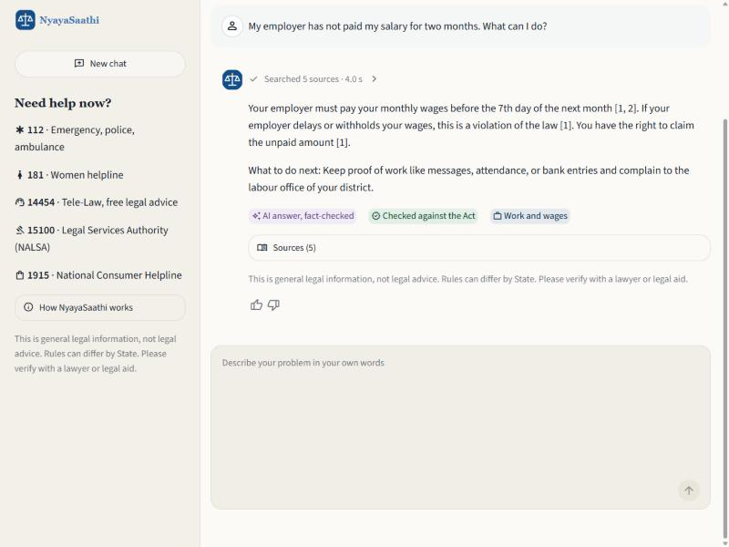
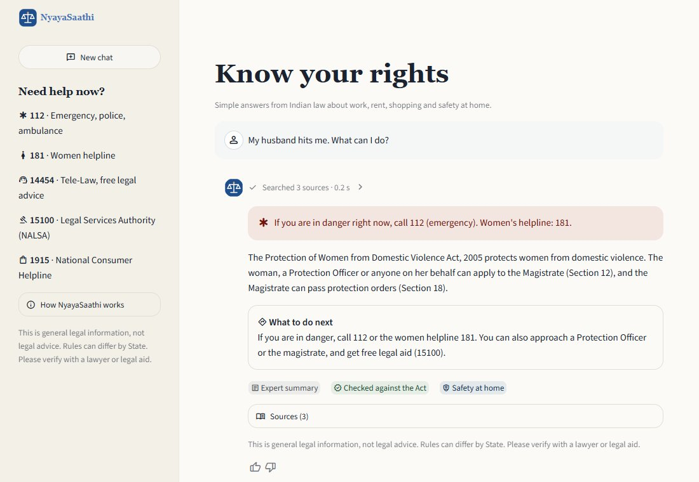

# NyayaSaathi ⚖️

**Know your rights, in simple words.**

NyayaSaathi answers everyday legal questions from people in India, like unpaid salary, a landlord keeping
a deposit, a broken product or violence at home. It answers from the official text of the law, cites
every source, checks its own answers for made-up facts, and says "I'm not sure" instead of guessing.



> General legal information only, not legal advice.

## What it does

- **Answers from the law**: 19 checked summaries plus 1,215 passages from 6 official Indian Acts.
- **Checks itself**: every number, helpline and section in an answer must appear in its sources.
  If not, the checked summary is shown instead.
- **Knows its limits**: refuses off-topic questions and weak matches, and points to free legal aid.
- **Safety first**: questions about violence or self-harm get emergency numbers straight away.
- **Works without an API key**: it then shows the checked summaries.



## How it works

1. **Safety check**: danger words add an emergency note.
2. **Topic check**: crime, property, divorce and cyber-fraud questions are refused politely.
3. **Search**: hybrid search (embeddings + keywords) finds the best checked summaries. If nothing is
   close enough, it says it isn't sure.
4. **Law lookup**: adds the exact Act sections those summaries cite.
5. **Answer**: Gemini writes a short, simple answer from only those numbered sources.
6. **Fact guard**: the answer must cite its sources and contain no fact that isn't in them.

## Topics covered

| Area | Examples | Law |
|---|---|---|
| Work and wages | Unpaid salary, minimum wage, overtime | Code on Wages 2019, OSH Code 2020, Social Security Code 2020 |
| Home and rent | Deposit, eviction, rent hikes | Model Tenancy Act 2021 |
| Shopping | Faulty goods, poor service, overcharging | Consumer Protection Act 2019 |
| Safety at home | Domestic violence, right to stay | DV Act 2005 |
| Free legal help | Free lawyers, Tele-Law | Legal Services Authorities Act 1987 |

## Results

On a test set of 50 questions (34 in scope, 16 off-topic):

| | Result |
|---|---|
| In-scope questions answered with the right topic | **94%** (32 / 34) |
| Off-topic questions refused | **100%** (16 / 16) |
| Generated answers with a fact not in the sources | **0%** (0 / 40, an earlier run) |
| Groundedness, scored 1-5 by a separate Gemini judge | **5.00** (53 answers) |

## Run it

```bash
pip install -r requirements.txt
streamlit run app/streamlit_app.py
```

Optional: copy `.env.example` to `.env` and add a free [Gemini API key](https://aistudio.google.com/apikey)
for AI-written answers. The first start downloads a small search model (~80 MB).

Run the tests with `python -m unittest discover -s tests`.

## Project structure

```
app/        the Streamlit app
src/        safety and topic checks, search, Gemini answer, fact guard and the pipeline
data/       checked summaries (kb.json) and the 6 official Act texts
eval/       test questions and evaluation scripts
tests/      32 unit tests
```

## Limits

- Small knowledge base: 19 summaries across 5 areas. Anything else is refused.
- The tenancy answers are not yet checked against the official Act text.
- The fact guard checks facts, not meaning, and the test set is small and self-written.
- English only.

## License

[MIT](LICENSE). The Act texts are Indian government publications, reproduced under
Section 52(1)(q) of the Copyright Act, 1957.
